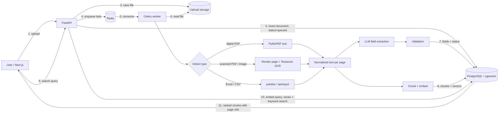

# Architecture

## 1. Component responsibilities

| Component | Role |
|---|---|
| **Frontend (Next.js, TypeScript)** | Upload UI, job status, search UI, viewing extracted fields and validation results. |
| **Backend API (FastAPI)** | Accepts uploads, validates type/size, stores the file, creates a DB record, enqueues a job, serves status and search endpoints. Never does heavy processing itself. |
| **Redis** | Celery broker and result backend (queue between API and workers). |
| **Worker (Celery)** | Does the heavy work: parsing, OCR, extraction, validation, chunking, embedding. Scaled independently of the API. |
| **PostgreSQL + pgvector** | Single store for metadata, extracted fields, validation results, text chunks and their embeddings. |
| **File storage (`UPLOAD_DIR`)** | Original files. A shared volume now; swappable for S3-compatible storage later. |
| **LLM API (`LLM_API_KEY`)** | Structured field extraction and embeddings. |

Backend layout (`backend/app/`): `api/` HTTP routes, `schemas/` request/response models, `models/` DB models, `services/` business logic (parsers, OCR, extraction, validation, search), `workers/` Celery tasks, `core/` config and shared infrastructure.

## 2. Data flow: upload to search

1. **Upload**: the API streams the file to disk while enforcing `MAX_FILE_SIZE_MB` and an allowed-type list, and computes a SHA-256 hash (duplicate detection).
2. **Enqueue**: a `documents` row is created (`queued`) and a task id returned immediately. The client polls status.
3. **Type detection**: by content, not file extension. A PDF page with almost no extractable text is treated as scanned.
4. **Text acquisition**: PyMuPDF for digital PDFs; Tesseract for scanned pages and images; pandas/openpyxl for spreadsheets.
5. **Large PDFs (~1000 pages)**: the parent task splits the document into page batches (e.g. 25 pages) processed as parallel Celery subtasks. Results are written per page, so progress is visible, failures retry per batch, and memory stays bounded.
6. **Extraction and validation**: the LLM returns structured fields (invoice number, date, totals, vendor...). Deterministic checks then validate them (required fields, date and number formats, line items sum to total, duplicate invoice numbers) and store a per-field confidence and validation status. Failures are flagged for human review rather than silently accepted.
7. **Indexing**: text is chunked (with page numbers), embedded, and stored in pgvector.
8. **Search**: query is embedded; hybrid retrieval combines vector similarity with PostgreSQL full-text search. Results return the chunk, document, and page number.

## 3. Why these tools

- **FastAPI**: async, typed, automatic OpenAPI docs, native Pydantic validation.
- **Celery + Redis**: OCR and 1000-page PDFs take minutes; they must not run in the request path. Celery gives retries, rate limits, and horizontal scaling. Redis is simple to operate.
- **PostgreSQL + pgvector**: metadata, validation results and vectors in one transactional database. One system to back up and secure, and SQL filters combine with vector search. Dedicated vector DBs are an option only at much larger scale.
- **PyMuPDF**: fast text extraction and page rendering for OCR.
- **Tesseract**: free, runs locally (documents never leave our infrastructure for OCR), supports many languages.
- **pandas / openpyxl**: standard tools for CSV/Excel.
- **Next.js (TypeScript)**: typed UI, easy to containerize.
- **Docker Compose**: one command reproduces the whole stack, including healthchecks and startup ordering.
- **pytest**: unit and integration tests for parsers and validators; `evaluation/` holds extraction-accuracy benchmarks against labeled samples.

## 4. Scalability

- **Stateless API** behind a load balancer; scale replicas freely.
- **Workers scale horizontally** (`docker compose up --scale worker=N`). Separate queues for light jobs (CSV, small PDFs) and heavy jobs (OCR, huge PDFs) so a 1000-page file cannot starve small ones.
- **Page-level parallelism and idempotent tasks** with retries and `acks_late`, so a crashed worker loses no work.
- **Backpressure**: bounded concurrency per worker, LLM call rate limiting and batching of embedding requests.
- **Database**: indexes on status/hash/date; HNSW index on embeddings; partitioning of the chunks table and read replicas if volume grows. Connection pooling (PgBouncer) when replicas increase.
- **Storage**: move uploads to S3-compatible object storage when running on multiple hosts.

## 5. Security

- **Upload hardening**: size limit, extension + magic-byte type check, generated storage filenames (no user-controlled paths), never executing uploaded content, optional antivirus scan.
- **Secrets** only through environment variables (`.env` is git-ignored; `.env.example` has placeholders only).
- **Authentication and authorization** (to be added): JWT/OIDC, per-tenant data isolation enforced in every query, role-based access.
- **Data privacy**: documents contain financial data. TLS in transit, encrypted volumes at rest, and only the minimum text is sent to the LLM provider; the choice of provider and its retention terms must be reviewed.
- **Prompt injection**: document text is untrusted input. LLM output is schema-validated and never executed; the LLM has no tools or write access.
- **Network**: Postgres and Redis are not published to the host; only API and frontend ports are exposed. Containers should run as non-root in production.
- **Auditability**: log who uploaded/viewed what and every validation decision, without logging document contents.

## 6. Current status

Implemented now: project skeleton, Docker Compose with healthchecks, `/health` endpoint (checks Postgres, pgvector extension and Redis). The database schema (8 tables, SQLAlchemy 2.0 + Alembic) is in place: see `docs/database_schema.md`. Upload, processing, search and the UI are not built yet.
