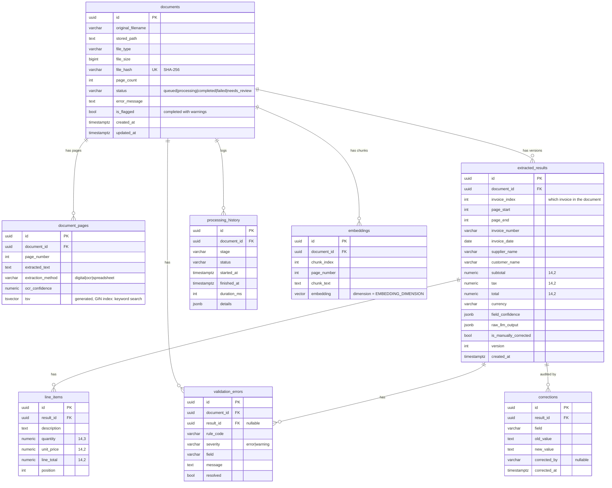

# Database schema

PostgreSQL 16+ with the `pgvector` extension. Models: SQLAlchemy 2.0 (`backend/app/models/`). Migrations: Alembic (`backend/alembic/`).

## ER diagram



## Conventions

- **Primary keys** are UUIDs generated by the database (`gen_random_uuid()`), so IDs can be created by either the app or SQL.
- **Money is `NUMERIC(14,2)`, never float.** Python side uses `Decimal`. Quantity is `NUMERIC(14,3)` because quantities can be fractional (e.g. 2.5 kg); that is not a money amount.
- **Timestamps are `timestamptz`.**
- **Status/severity/method columns** are `VARCHAR` with a `CHECK` constraint rather than native Postgres enums, so adding a value is a simple constraint change, not `ALTER TYPE`.
- **Deletes cascade** from `documents` to every child table, and from `extracted_results` to its line items, validation errors and corrections. Deleting a document removes everything about it.
- **Every foreign key is indexed.** Where a composite unique constraint starts with the FK column (`document_pages`, `extracted_results`, `line_items`, `embeddings`) it doubles as that index, so no redundant single-column index is created. `tests/test_schema.py` enforces this for all tables.
- **Constraint names are deterministic** (naming convention in `models/base.py`), so Alembic can alter/drop them.

## Tables

### documents
One row per uploaded file; the hub every other table hangs off.
- `file_hash` is the SHA-256 of the content with a **unique index**: uploading the same file twice fails with a constraint error the API turns into a "duplicate" response.
- `status` drives the pipeline: `queued` → `processing` → `completed` | `failed` | `needs_review` (extracted but validation errors need a human). Indexed, because the UI and workers filter by it.
- `is_flagged` is true when the document is `completed` but still has unresolved validation warnings.
- `error_message` holds the failure reason when `failed` (or a summary when `needs_review`). `page_count` is filled after parsing.

### document_pages
Text per page. Written per page (or page batch) so a 1000-page PDF shows progress and a failed batch can retry without redoing the rest. `extraction_method` records how the text was obtained; `ocr_confidence` (0-100, Tesseract scale) is only set for `ocr`. Unique on `(document_id, page_number)`, which also makes batch retries idempotent.

### extracted_results
The structured invoice fields from the LLM. A document can hold **many invoices** (`invoice_index`, with the `page_start`/`page_end` it came from) and **several versions**: each extraction run writes a new `version` for all its invoices and old versions are kept. Unique on `(document_id, version, invoice_index)`. `field_confidence` (JSONB) maps field name → confidence; `raw_llm_output` keeps the untouched model response for debugging and re-validation. `is_manually_corrected` flags human-reviewed data. `invoice_number` is indexed for lookup and duplicate-invoice checks. All fields are nullable because extraction can fail per field; validation rules report that, not the schema.

### line_items
Invoice rows belonging to one result. `position` preserves the original order (unique per result).

### validation_errors
Outcomes of deterministic checks (e.g. `TOTAL_MISMATCH`, `MISSING_INVOICE_NUMBER`). `rule_code` is a stable machine-readable code; `message` is human-readable; `severity` is `error` or `warning`; `field` names the offending field; `resolved` is set when a reviewer fixes or dismisses it. `result_id` is nullable because some problems (e.g. unreadable file) exist before any result does.

### processing_history
Append-only log of each pipeline stage attempt (`parse`, `ocr`, `extract`, `validate`, `embed`...). `status` is `started`/`succeeded`/`failed`/`skipped` (convention, not constrained, so new stages need no migration). `duration_ms` makes slow stages easy to find; `details` (JSONB) carries stage-specific data such as page range, retry count or error trace. Indexed on `(document_id, started_at)` for a document's timeline.

### corrections
Audit trail of manual edits to extracted values: which `field` changed from `old_value` to `new_value`, and when. Values are stored as text so one table covers strings, dates and decimals. Rows are never updated. `corrected_by` is **an addition to your spec**: it is nullable and unused until authentication exists, since "who changed it" cannot be recorded without it.

### embeddings
(Search: `document_pages.tsv` is a generated `tsvector` (`simple` configuration, so no stemming and no language assumptions) with a GIN index for keyword search; `embeddings.page_number` tells which page a chunk came from. See `docs/search.md`.)

Text chunks and their vectors for semantic search. `embedding` is `vector(N)` where **N is `EMBEDDING_DIMENSION`** (default 1536). The index is **HNSW with cosine distance** (`vector_cosine_ops`, `m=16`, `ef_construction=64`), so query with `ORDER BY embedding <=> :query LIMIT k`. Unique on `(document_id, chunk_index)`.

Notes on the dimension:
- It is read when the migration runs and baked into the column type. Changing the embedding model to a different dimension needs a new migration plus re-embedding all chunks (vectors of different sizes cannot be compared).
- pgvector's HNSW index supports at most **2000 dimensions** for the `vector` type. For larger models, use `halfvec` or reduce dimensions.

## Running migrations

```bash
cd backend
alembic upgrade head          # apply
alembic downgrade base        # roll back everything (keeps the vector extension)
alembic revision --autogenerate -m "describe change"   # after editing models
alembic check                 # fails if models and migrations have drifted
```

In Docker Compose the backend container runs `alembic upgrade head` on start. The worker does not; it depends on the backend being healthy. `DATABASE_URL` keeps the plain `postgresql://` form; the app rewrites it to `postgresql+psycopg://` for SQLAlchemy.
