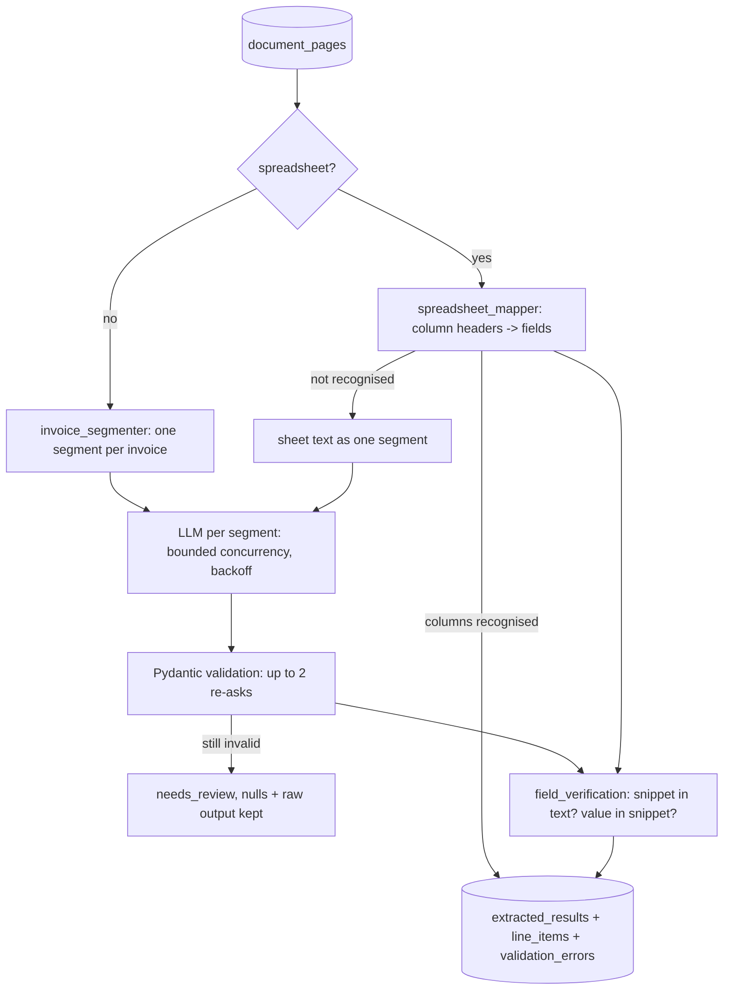

# Invoice field extraction

Code: `backend/app/services/extraction_service.py` (entry point `extract_document(session, document_id, llm=None)`). Prompt: `backend/app/prompts/extraction_v1.txt`. Runs after `pipeline.process_document` has saved the page text.

## Hard rules, and where they are enforced

| Rule | Enforcement |
|---|---|
| Not stated in the text means `null`; never guess or compute | Prompt rule 1, plus the checks below: a value only survives if it can be traced to the text. |
| Every value has a confidence (0-1) and a `source_snippet` | Required by the JSON schema. Stored per field in `extracted_results.field_confidence` as `{field: {confidence, source_snippet}}`; line items under the key `line_items`. |
| Snippet not in the text means the value is voided | `field_verification.verify_field`: the snippet must occur in the document text (case and whitespace ignored). Otherwise the value becomes null and a `validation_errors` warning (`EXTRACT_SNIPPET_NOT_FOUND`, `EXTRACT_NO_SNIPPET`) is saved. |
| (extra) the value must be inside its snippet | Names must appear in the snippet, amounts must equal a number in the snippet, dates must be real ISO dates, ambiguous ones (`03/04/2026`) become null. Currency is only checked to be a 3-letter code. |
| Output validated with Pydantic, max 2 retries, then `needs_review` | `extraction_schema.LLMExtraction`. A failed attempt is sent back to the model with the validation error. After 3 calls the invoice gets a row with null fields, the raw outputs, an `EXTRACT_LLM_OUTPUT_INVALID` error, and the document becomes `needs_review`. |
| JSON mode, temperature 0 | JSON-schema structured output (`output_config.format`). **Temperature is not sent**: see below. |
| Prompt in its own file | `prompts/extraction_v1.txt` (`### SYSTEM` / `### USER` sections). New version = new file + change `PROMPT_NAME`; the version is saved in `raw_llm_output`. |

### Temperature

The Claude API rejects `temperature`, `top_p` and `top_k` with HTTP 400 on every model (since API version 2026-10-21). The `LLMClient` interface still carries `temperature=0.0` (a provider that supports it can use it); `AnthropicLLMClient` omits it. Output stability comes from the JSON schema, the null/snippet rules, and the verification step. Expect small run-to-run differences in confidence values.

## Large documents

- `invoice_segmenter` splits pages into invoices without calling the LLM: a different invoice number starts a new invoice; a page with an invoice header and no number starts one when the previous invoice already had a total (and the page isn't "continued" / "page 2 of 3"). Pages with no number and no header join the current invoice.
- Each invoice is a separate LLM call (`LLM_CONCURRENCY`, default 4). A 429 pauses all workers (shared gate, honours `retry-after`); rate-limit, network and 5xx errors retry with exponential backoff and jitter, up to `LLM_MAX_ATTEMPTS` (5).
- A bad API key (or retries exhausted) stops the document early and marks it `failed`; pending calls are cancelled.
- An invoice over `EXTRACTION_MAX_SEGMENT_CHARS` is not sent; it gets `EXTRACT_SEGMENT_TOO_LARGE` and review status. Nothing is truncated silently.

## Spreadsheets

`spreadsheet_mapper` looks for a header row (first 20 rows) and matches column names (`Invoice No`, `Total`, `Date`, `Supplier`..., plus a few German names) case-insensitively. A sheet is mapped without the LLM when it has an invoice-number column **and** a total column.

- One row per invoice: each row becomes an invoice.
- Line-item sheets (description / qty / price columns): rows are grouped by invoice number. A bare `Total` column there is a *line* total, so the sheet goes to the LLM unless a column is named like `Invoice Total` / `Grand Total`.
- Mapped values get confidence 0.95; the raw cell is the snippet and is verified against the text like any other value. Ambiguous dates (`03/04/2026`) and ambiguous numbers (`1,250`) are left null, not guessed.
- Sheets that can't be mapped are sent to the LLM as one segment per sheet.

## Saved data

Per invoice: one `extracted_results` row (`invoice_index`, `page_start`, `page_end`, `version`), its `line_items`, and any `validation_errors` the extraction itself raised (rule codes start with `EXTRACT_`; discarded values are warnings, unusable output is an error). `raw_llm_output` holds the prompt version, model, every attempt's raw text with its validation error, and the parsed result. Re-running creates `version + 1`; earlier versions are kept.

On success the document stays `processing` (the validation stage comes next). `needs_review` if any invoice failed; `failed` if the LLM is unavailable. Each stage (`segment`, `extract_fields`, `save_results`) is logged in `processing_history` with LLM call counts, retries, rate-limit hits and token usage.

## Provider interface

`services/llm_client.py`: `LLMClient.complete_json(system, messages, json_schema, temperature, max_tokens) -> LLMResponse`. To change provider, subclass it, raise `LLMRateLimitError` / `LLMTransientError` for retryable problems and `LLMError` otherwise, and add it to `get_llm_client()` (`LLM_PROVIDER`). Tests use `tests/mocks.py:MockLLM`; no real API is called.

## Settings

`LLM_PROVIDER`, `LLM_API_KEY`, `LLM_MODEL` (`claude-opus-5-5`), `LLM_EFFORT` (`high`), `LLM_MAX_OUTPUT_TOKENS`, `LLM_REQUEST_TIMEOUT_SECONDS`, `LLM_USE_REFUSAL_FALLBACKS`, `LLM_CONCURRENCY`, `LLM_MAX_ATTEMPTS`, `LLM_BACKOFF_BASE_SECONDS`, `LLM_BACKOFF_MAX_SECONDS`, `LLM_MAX_VALIDATION_RETRIES`, `EXTRACTION_MAX_SEGMENT_CHARS`.

## Known limits

- The Anthropic adapter is covered by unit tests with a fake SDK client, not by a live call (no API key was available): the first real run may need adjustments to request options.
- Segmentation is heuristic. Invoices without numbers or headers in one document may be merged; the LLM then flags `EXTRACT_MULTIPLE_INVOICES` and only the first is extracted.
- Per-field confidence is the model's own estimate, not a calibrated probability.
