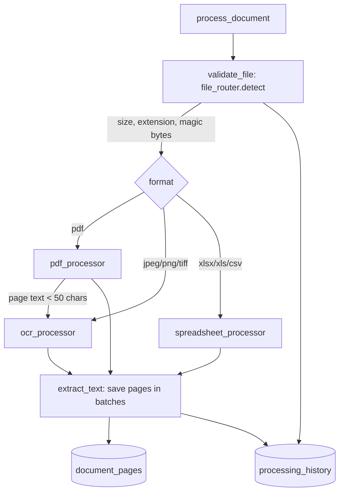

# File processing pipeline

Code: `backend/app/services/`. Entry point: `pipeline.process_document(session, document_id)`.

| Module | Does |
|---|---|
| `file_router` | Checks size (0 bytes, `MAX_FILE_SIZE_MB`), the extension, and the real format from magic bytes. A PNG named `.jpg` is reported, not accepted. The user's original filename decides the extension, so stored files can have generated names. |
| `pdf_processor` | PyMuPDF, one page at a time, yielded in batches (`PDF_BATCH_SIZE`, default 5, so progress moves every few pages even for slow OCR scans). Pages with under `PDF_MIN_TEXT_CHARS` (50) characters are rendered at `OCR_DPI` and OCR'd; the longer of OCR/embedded text wins. A 1000-page PDF is read without holding it in memory. |
| `ocr_processor` | Tesseract. Preprocessing: grayscale, upscale tiny images, denoise, deskew (±10°), CLAHE contrast. Saves mean word confidence (0-100) per page; blank page = 0.0. Multi-page TIFF: one page per frame. Handles EXIF rotation, transparency, 16-bit/CMYK/palette images. |
| `spreadsheet_processor` | XLSX (openpyxl), XLS (xlrd), CSV (chardet for encoding, csv.Sniffer for the delimiter). Each sheet is read separately; empty sheets are skipped and listed in the log; merged cells are filled with the merged value. Sheets are split into pages of `SPREADSHEET_ROWS_PER_PAGE` (1000) rows, as tab-separated text starting with `# Sheet: <name> (rows a-b)`. |
| `pipeline` | Runs the stages, writes `document_pages`, commits per batch, logs each stage. Re-running a document replaces its pages. |

## Failures

Each expected failure has its own exception (`services/exceptions.py`) with a stable `code` and a user-readable `message`:

| Exception | code | Example |
|---|---|---|
| `UnsupportedFormatError` | `unsupported_format` | `.docx`, `.txt` |
| `ExtensionMismatchError` | `extension_mismatch` | PDF content in a `.xlsx` |
| `FileTooLargeError` | `file_too_large` | over `MAX_FILE_SIZE_MB`, or an image with too many pixels |
| `EmptyFileError` | `empty_file` | 0 bytes, no PDF pages, all sheets empty |
| `CorruptedFileError` | `corrupted_file` | damaged PDF/ZIP/image |
| `PasswordProtectedError` | `password_protected` | encrypted PDF/XLS/XLSX |
| `OCRError`, `OCRUnavailableError` | `ocr_failed`, `ocr_unavailable` | OCR timeout; Tesseract or language pack missing |

`process_document` never raises for these: it sets `documents.status = failed` and `error_message`, and returns an `Outcome`. An unexpected bug is also caught: the user sees a generic message, and the traceback goes to the `processing_history` row and the server log. A single page that fails (e.g. one bad PDF page) does not fail the document; it is saved with empty text and listed in `failed_pages` in the history details.

## Logging

Each stage (`validate_file`, `extract_text`) writes a `processing_history` row **when it starts** (`status=started`) and updates it when it ends (`succeeded`/`failed`, `finished_at`, `duration_ms`, `details`). Details include format, page counts, OCR/digital page counts, skipped sheets, failed pages, or the error.

## Status after this stage

On success the document stays `processing` (later stages, LLM extraction and validation, will finish it) and `page_count` and `file_type` are set. On failure it is `failed`.

## Settings (env vars)

`OCR_LANGUAGES` (`eng`; Docker: `eng+ben`), `OCR_DPI` (300), `OCR_TIMEOUT_SECONDS` (120 per page), `OCR_MAX_PIXELS` (40M), `PDF_MIN_TEXT_CHARS` (50), `PDF_BATCH_SIZE` (5), `IMAGE_BATCH_SIZE` (3), `SPREADSHEET_ROWS_PER_PAGE` (1000).

## Known limits

- XLSX is loaded fully into memory (needed to resolve merged cells); a 200 MB workbook will use a lot of RAM.
- Password-protected files are rejected, not unlocked.
- OCR does not auto-rotate sideways (90°) pages.
- Sample files: `sample_data/` (regenerate with `python scripts/generate_sample_data.py`).
